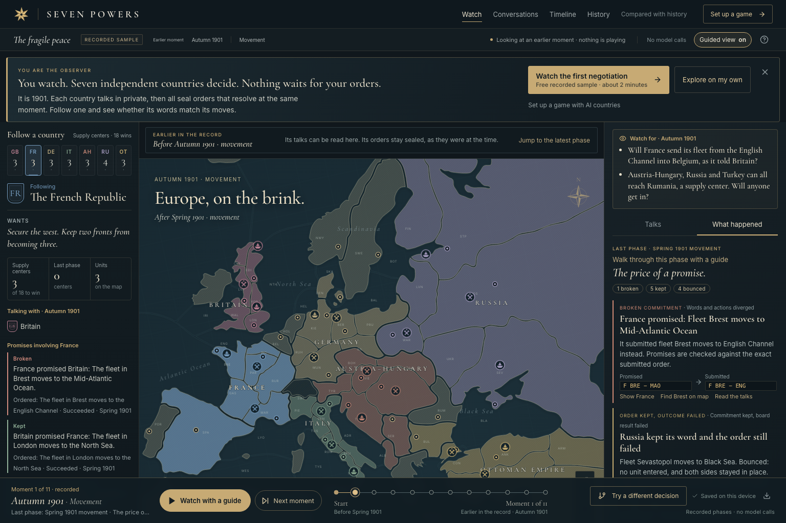

# Seven Powers

An AI Diplomacy observatory: seven independent countries, private negotiations, simultaneous orders, and a continent whose history can branch.



## Run locally

Requirements: Node **22.13+**, pnpm **10**, Python **3.12**, and [uv](https://docs.astral.sh/uv/).

```sh
pnpm install
pnpm setup:engine
cp .env.example .env
pnpm dev
```

Open **http://127.0.0.1:5173**. On first startup, the server creates an eleven-phase sample replay using the real adjudicator. No API key is required to explore it or run a sandbox.

For real agents, put your **OpenRouter** key in `.env`:

```dotenv
OPENROUTER_API_KEY=your-key
```

Restart the server and press **Set up a game**. The four steps are Players, Guidance (an optional shared briefing, plus optional instructions that only one country reads), Length (phase limit and budget ceiling), and Start. Every default works, so a novice can press **Start game** on the first pass. Nothing calls a model until that press. Model selection uses OpenRouter’s current catalog and lists only models that accept chat-completions requests, support structured output, and publish token prices. The key is server-side only and excluded from Git and replay exports.

The defaults are the economical pair **GLM 5.3 Flash** (`z-ai/glm-5.3-flash`) and **Claude Haiku 5.5** (`anthropic/claude-haiku-5.5`). Both run at low reasoning effort. Presets assign either model to all seats or alternate them.

For a built local app:

```sh
pnpm build
pnpm start
```

Open **http://127.0.0.1:3001**. Vite is development-only; Express serves the built application in this mode. Both services bind to loopback. This is a single-operator local application, not a publicly exposed multi-user service.

## Reading the observatory

The first screen states the role in one line: seven countries negotiate in private, then seal secret orders that resolve together, and 18 of 34 supply centers wins. You are the observer and nothing needs your input. The welcome card can be hidden, and **How to watch** brings it back.

Three labels describe where the record comes from. **Recorded sample** replays an authored game through the real rules engine, with no model calls. **Local sandbox** runs deterministic local policies. **Live agents** calls real models, and cost appears in the status bar.

A **moment** is the board at the **start** of a phase. Moment 1 of the sample, for example, shows the start of Autumn 1901 movement, and the story panel describes the Spring 1901 movement that produced it (“last phase”). The guide strip reads one of four ways: *earlier in the record* when you are viewing the past, *happening now* while a phase is being played, *next phase* at the latest moment before anything runs, or *match complete*.

The **Happening now** strip shows three steps: private talks, sealed orders, and resolution. Its counts come from the recorded state. Sealed orders stay hidden until every country has submitted and the rules engine resolves them together. Retreats and adjustments skip talks.

**What happened** explains the last resolved phase in plain language: broken commitments (promised order beside the submitted one), kept commitments whose order still failed, supply centers that changed hands, bounced attacks, and successful moves into occupied provinces. Each moment links to its country, to the map, or to the dispatches. Every submitted order is listed underneath, with its exact engine text.

### Watching a game

**Start game** creates the game and plays its first phase. From then on the page holds one *watch session* for that game, and the session is the only thing that ever asks the server for a phase, one at a time:

- **Guided view on (the default).** Each phase that resolves opens its walkthrough on its own: what happened, why it matters, and the province on the map, one popup per event, with **Back**, **Next event**, and **Skip to phase summary**. The next phase waits until you press **Continue watching** on the summary. The status line reads *Reading · the next phase waits for Continue watching*. The final phase offers **See the result** instead.
- **Guided view off.** The game plays on, one phase at a time with a short gap, until you pause it or it reaches its limit.
- **Pause game** always reaches the server, even while the request for a phase is still in transit, and shows **Pausing…** until the server is idle. A phase in progress stops after its current model call.
- **Closing, hiding, or leaving always pauses.** Closing the guide, turning guidance off, toggling Guided view, opening any dialog, switching to any other tab, scrubbing the timeline, hiding the browser tab, opening another game, and refreshing all end the session. Nothing resumes until you press **Resume game** (or Continue watching while a phase is held).
- **Play next phase** plays exactly one phase and stops.

Every order in a phase still resolves at the same moment; the event popups are narration of that one resolution, in order of importance.

### Replaying a record

Any record (the sample, a sandbox game, or a live game, finished or paused) replays from any recorded moment with no request to the server and no cost. With Guided view on, **Watch with a guide** walks the recorded phases; with it off, **Play replay** advances them on a timer, and **Replay speed** sets its pace. Looking at the past of an unfinished game, **Resume at latest** is a separate, labelled control; the primary control never jumps to a billed phase. A dialog, tab switch, or hidden page also stops the free replay timer.

## What you can do

- Watch a selectable, pannable, zoomable standard-map Europe. Toggle revealed movement arrows and inspect supply centers and units.
- Inspect every country’s objective, decision summaries, trust assessments, private correspondence, and memory at a particular checkpoint.
- Read bilateral and group messages, and compare exact promised orders with the orders actually issued. A kept promise can still fail tactically.
- Find every game you started in **History**: its mode, phases, cost, and true result (a phase limit is never shown as a win). **Open** loads a game at its latest moment and **From the start** at its opening; neither plays anything. **Delete** asks first and removes a game for good; the sample cannot be deleted, a running game cannot be deleted, and an alternate timeline whose original was deleted keeps working.
- Replay saved phases, seek through the timeline, and export a JSON archive. Games are automatically persisted in SQLite under `data/`.
- Branch at any nonterminal checkpoint. Override one legal order, inject a private diplomatic message, or change a country’s profile. The branch restores past memory and excludes the original future. Compare both continuations side by side.
- Use competitive, coalition-building, opportunistic, or historically informed profiles. Historical interests start in 1901; future alliances and events are not supplied to agents.
- Explore **Compared with history**, which combines current observations with linked museum and government sources and explains the game’s historical limitations.

### Three clearly separated modes

**Sample replay:** authored teaching dialogue and opening orders, followed by deterministic continuation. Every phase is adjudicated by the actual engine. It is not presented as an AI run.

**Local sandbox:** a deliberately simple deterministic policy selects legal orders. It is useful for exploring rules, playback, and order branches; it is not a strong Diplomacy player. Messages are recorded but do not influence this policy. Profiles alter deterministic order ranking rather than producing sophisticated historical behavior.

**Live agents:** each country receives an independent model call with its own objective, profile, memory, eligible messages, legal orders, and public board history. Real model outputs determine negotiation and orders; the adjudicator determines outcomes. Mixed models and a uniform-model setup are both supported. No benchmark or human-level play claim is made.

### Pause, costs, and recovery

Pause stops **after the current model request settles**, before sending another request or adjudicating. Every request for a phase carries a ticket, and the pause carries the same ticket: if the pause reaches the server before its request, the request is refused and no phase is played. A model request has a 120-second timeout. Each call uses low reasoning effort for the two economical models, with no retries. Completed requests and partial phases are saved, so resuming does not repeat already accepted negotiations or decisions. A restarted server recovers running matches as paused; it never resumes spending automatically.

The service reserves a conservative price allowance before every request using UTF-8 prompt bytes, a protocol/schema allowance, output limits, and current catalog prices. Where the catalog defines a higher long-prompt tier (Haiku 5.5 is priced higher from 100,000 prompt tokens), the reservation uses that tier once the prompt reaches its threshold. The advertised base rate alone is never used for such prompts. Completed calls use provider-reported cost where available; otherwise the UI labels estimates. Failed or interrupted calls retain their reservation because billing may have occurred. SDK retries are disabled. Budget limits stop additional calls; they are not a substitute for an account-level OpenRouter credit limit if upstream prices or billing behavior change.

The phase limit counts all resolved phases, including retreats and adjustments. Reaching it ends the *run*, not necessarily the Diplomacy game. An engine-declared solo or draw also ends play. Branching supplies a fresh continuation budget and limit. Only one match runs at a time.

Invalid model output or illegal/incomplete order sets pause with an explicit error. Invalid orders never silently become successful actions. Resuming may require fresh decision calls after a rejected order set. Saved, resolved turns remain intact.

## Architecture

| Layer | Implementation |
|---|---|
| Interface | React 19, TypeScript, Vite, local fonts, Lucide, SVG map |
| API | Express 5, Zod input validation, loopback-only access |
| Agents | Vercel AI SDK 6 + `@openrouter/ai-sdk-provider`, structured output |
| Rules | Python `diplomacy==1.1.2`, JSON subprocess boundary |
| Persistence | Node SQLite, WAL, durable serialized matches and partial phases |
| History | Immutable completed turns, per-phase engine/memory checkpoints, independent branches |

`server/privacy.ts` is the explicit allowlist boundary for model observations. Spectators can read all private diplomacy; model calls cannot. Sealed decisions and other countries’ memories never enter an agent observation. Private message content is treated as untrusted game communication by the system prompt.

The map uses jDip standard-map geometry, extracted from the engine package with `scripts/extract_map.py`. Province fill indicates a combination of starting national geography and recorded influence; **supply-center dots and center counts are authoritative ownership**, not the area of the colored land. Army and fleet tokens track engine positions. Coast-specific orders preserve the engine’s coast notation.

For design, source selection, verification evidence, and known limits, see:

- [Research and architectural decisions](docs/RESEARCH.md)
- [Design contract and visual verification](docs/DESIGN.md)
- [Verification record](docs/VERIFICATION.md)
- [Third-party sources and licenses](docs/THIRD_PARTY.md)

The adjudicator is AGPL-3.0 and the inherited map carries jDip GPL attribution. The applicable upstream notices are preserved. Distribution or public hosting must account for those terms; no public deployment is configured here.

## Verification

```sh
pnpm lint
pnpm typecheck
pnpm test
pnpm test:datc
pnpm exec playwright install chromium
pnpm test:browser
pnpm build
```

Browser tests start a separate built server on port 3012 with a fresh database in a temporary folder, and with `OPENROUTER_API_KEY` set to an empty string, so a key in `.env` is never loaded and no test can bill (`tests/browser/no-billing.spec.ts` asserts it). Tests that need the live setup screens fake `/api/health` and the model catalog in the browser. The watch-session regressions are in `tests/browser/watch.spec.ts` and the guided-card layout checks in `tests/browser/layout.spec.ts`. Provider-contract tests mock the HTTP boundary; the verification record separately identifies the earlier paid model runs.

To spend a small, capped amount on the economical models, run the bounded live proof once. It makes one phase with one diplomacy round, alternating GLM 5.3 Flash and Haiku 5.5, with a hard budget of $0.10. It writes its record to the local archive, and it prints transport facts only, never the key or headers. The records of earlier proof runs were deleted from the local archive at the owner's request; their results remain in the verification record as history:

```sh
pnpm exec tsx scripts/live-proof.ts
```

The most recent result, which is partial, is recorded in [VERIFICATION.md](docs/VERIFICATION.md).

The local tests cover full simulation flow, private projections, sealed orders, durable checkpoints, branching, budget refusal before sending, provider failure without retries, and standard rules including support cutting, convoys, retreats, builds, and disbands. The upstream DATC suite adds the engine’s specialized adjudication cases.

## Operating boundaries

- One Node process and a local SQLite database. Do not run multiple orchestration processes against one database. Multi-user hosting would require authentication, tenant isolation, and a durable job queue.
- A model’s requested order need not be strategically good. This app verifies legality, not strategic strength.
- Requests in a diplomacy round run sequentially; a later country can receive earlier countries’ messages from that round. Decision calls never see one another’s sealed orders.
- Saved JSON exports are readable archives. The UI replays the durable local archive; it does not currently import external match files.
- Branch comparisons show their actual phase labels. When retreat phases diverge, the closest available checkpoint by sequence is shown, with a warning if the phases differ.
- Historical profiles are bounded editorial interests, not recreations of specific leaders or factual forecasts.
# diplomacy-ai
